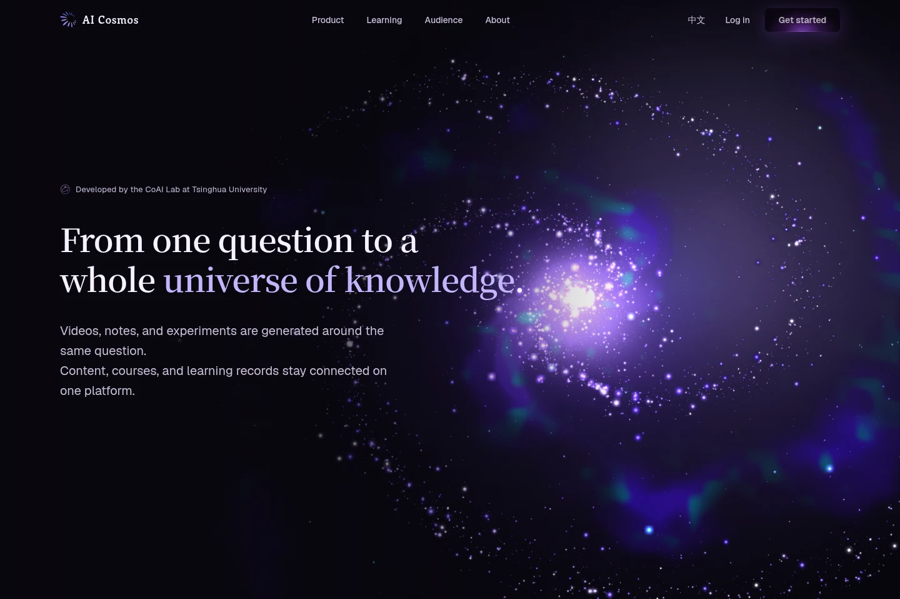

# Edumanus Landing Page · Edumanus 产品首页

[English demo](https://jjchess.github.io/Eregion/demos/edumanus-landing/?lang=en) · [中文演示](https://jjchess.github.io/Eregion/demos/edumanus-landing/?lang=zh) · [Source](src/)



## English

The AI Cosmos product homepage, extracted from Edumanus into a standalone portfolio work. A draggable galaxy opens the page; its stars dissolve into the background as the visitor scrolls. Five product covers expand into video demonstrations, followed by scroll-driven text, audience stories and an isometric image field.

The archive preserves the product page's composition, typography, shader, section transitions and video interactions. Its English and Chinese editions share one source tree and one URL with `?lang=en` or `?lang=zh`. All runtime assets are hosted with the demo.

This is a presentation of the homepage UI, not a hosted Edumanus workspace. Login, registration and product-documentation entries explain the demo boundary locally. No account is created, and the page does not call product APIs. The embedded videos show recorded product demonstrations; they do not perform live generation, run experiments or connect to classrooms.

### Run

Use Node.js 22.12 or later. From the repository root:

```bash
cd works/edumanus-landing/src
npm ci
npm run dev -- --port 4182
```

To type-check and create the static demo:

```bash
npm run build
```

The build writes `../demo/` and uses relative assets so the complete page works under a GitHub Pages subdirectory. To preview it inside the portfolio, run from the repository root:

```bash
python3 scripts/build.py
python3 scripts/serve.py --port 4179
```

Open `http://localhost:4179/portfolio/demos/edumanus-landing/?lang=en`, or change the language to `zh`. The homepage and archive card open this complete page directly. Archival details remain available at `/portfolio/projects/edumanus-landing/` and `/portfolio/zh/projects/edumanus-landing/`.

### Provenance and scope

The source is Edumanus frontend `components/landing/LandingPage.tsx` and its actual dependency closure, the shared AI Cosmos logo and landing translations. The reviewed source revision is `8618744e1597811d433749996fd71b171673db94`; the relevant source and media paths were clean at inspection. `src/source-manifest.json` records the extracted source files.

Product implementation and archive adaptation include the continuous galaxy, product integration, bilingual presentation, inner-scroller coordination and responsive composition. The standalone edition removes application authentication and business providers, adapts Next-specific wrappers for Vite, preserves local video playback and adds a language control. AI Cosmos product branding and its institutional attribution describe the original product; they are not a claim that this personal portfolio represents the institution or that all contributing code and artwork are original to its owner.

The product-cover transition, text animation and isometric grid draw on credited Codrops examples. Their applicable licenses and upstream authors remain with the archive. See [THIRD_PARTY_NOTICES.md](THIRD_PARTY_NOTICES.md) and [licenses/](licenses/) for code, imagery, runtime and font attribution. The product source has no blanket application license; this archive does not grant a new one.

### Media and limits

Product videos are existing marketing demonstrations, not synthetic recordings. The archive masks identified account/avatar and classroom-member record regions; corresponding posters and chapter images are derived from the processed videos. The asset review uses every still image plus sampled video frames, not an assertion that every frame was manually reviewed. No authentication tokens, application credentials, environment files, backend code or private conversation exports are included.

Physical phone/trackpad elastic scrolling and hardware frame rates have not been measured. Browser checks use official Google Chrome with software WebGL rendering. Reduced-motion and WebGL fallback behavior preserve readable content; a still preview cannot represent all motion.

## 中文

这份作品将 Edumanus 的 AI Cosmos 产品首页整理为独立页面。银河支持拖动与键盘操作，并随滚动散入背景星空；五组产品封面展开为视频演示，随后通过滚动文字、面向不同人群的内容与等距图片阵列完成整页体验。

归档保留原页面的构图、字体、着色器、区段转场和视频交互。中英文共用源码，通过 `?lang=en` 或 `?lang=zh` 访问，运行素材随页面托管。安装、构建和 4179 本地预览命令见上方。

这是首页 UI 的展示，不是可登录的 Edumanus 工作区。登录、注册和产品文档入口在本地说明演示范围，不创建账号、不调用业务 API。视频展示已有产品录屏，不在浏览器中执行真实生成、实验或课堂连接。

源码来自上述 Edumanus 版本的 LandingPage 依赖闭包。归档适配移除认证和业务 Provider，改为可独立构建的 Vite 页面，并保留银河、滚动、双语和完整视频交互。产品中的 AI Cosmos 品牌和机构归属描述原产品，不代表个人作品集代言该机构，也不将全部上游设计与素材归为本人原创。Codrops 示例、照片、依赖和字体的来源与许可见共用声明。

视频为已有营销演示录像；识别到的账号、头像及课堂成员记录区域已做遮蔽，对应海报和章节图从处理后录像重新截取。素材检查覆盖全部静态图片和视频抽样帧，不宣称逐帧审完。归档不包含认证凭证、环境配置、后端实现或私人对话导出。

尚未进行物理手机／触控板弹性滚动或硬件帧率实测；浏览器验收使用官方 Chrome 和软件 WebGL。具体检查结果记录在下方。

## Validation / 验证

A clean `npm ci`, TypeScript checking and the Vite production build passed. The archive retains 80 runtime media files with recorded hashes, complete dependency/font notices, and a real 1440 × 960 Chrome preview. The video files are loaded on demand.

The browser harness attaches to an existing official Chrome instance over CDP. Keep the 4179 preview running, then execute from the repository root:

```bash
CDP_PORT=9224 PLAYWRIGHT_MODULE=/path/to/playwright node tests/landing-browser.cjs
```

Use the repository preview server for video testing: it implements HTTP Range responses so chapter seeking behaves like the deployed static site. The test checks actual video decoding and seek positions, not just the appearance of video controls.

干净安装、TypeScript 检查和 Vite 生产构建已通过。归档保留 80 个运行素材及哈希记录，预览图为官方 Chrome 的真实截图。视频按需加载；浏览器检查需使用仓库提供的预览服务器，以验证真实的分段读取和章节定位。

Fourteen acceptance groups passed in official Chrome 155.0.8059.84 across the desktop and focused mobile/fallback runs:

- The real galaxy renderer, drag and keyboard controls, scroll dissolve and all four header anchors.
- All five videos decode and play. Ten desktop chapter selections reach their intended timestamps within 0.004 seconds; closing restores focus and the scroll position at the actual opening click.
- English/Chinese switching and refresh, local account-action dialogs, 390/320 px layouts, and a 320 × 600 player with a usable nested scroll region and no outer-page movement.
- Reduced motion and unavailable WebGL retain the complete page and playable media. Exercised paths have no uncaught exceptions, missing resource responses or external business/asset requests.

The local archive's 34 Python checks and the isolated publication snapshot's 31 checks passed. Both local `/portfolio/` and production `/Eregion/` static builds passed. Browser automation does not replace the physical-device checks noted above.

官方 Chrome 155 的桌面与手机／降级分段回归共通过 14 组检查：真实银河渲染与输入、四个导航锚点、五个视频播放和章节定位、中英切换刷新、本地说明弹窗、320/390 布局，以及 320 × 600 短屏的嵌套滚动。关闭视频恢复实际打开瞬间的焦点与滚动位置；减少动态效果和 WebGL 不可用时仍能浏览并播放。已测流程无未捕获异常、资源缺失或外部业务／素材请求。本地与独立发布快照的 Python 检查、两种子路径构建均已通过。
