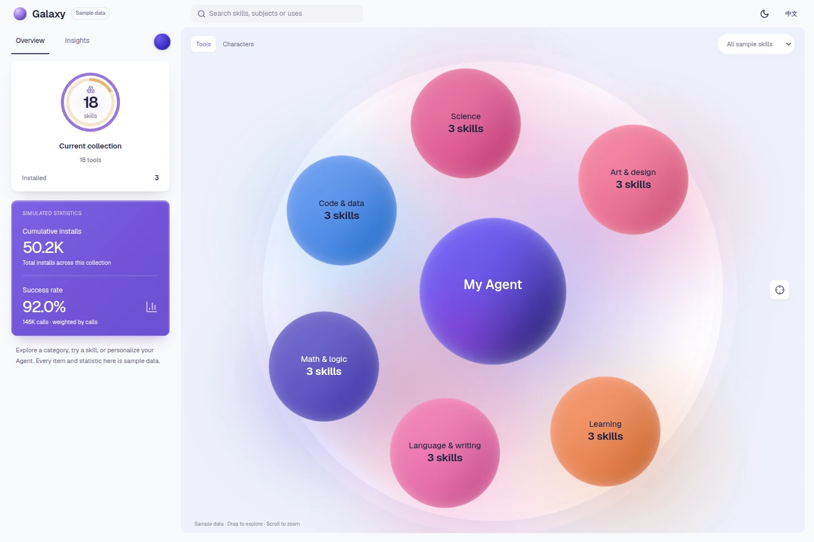

# Galaxy Skill Market · 技能星图

[English portfolio](https://jjchess.github.io/Eregion/projects/galaxy-skill-market/) · [中文作品页](https://jjchess.github.io/Eregion/zh/projects/galaxy-skill-market/) · [Interactive demo](https://jjchess.github.io/Eregion/demos/galaxy-skill-market/) · [Source](src/)



## English

Galaxy Skill Market turns a skill catalog into a navigable pearl-like galaxy. The central Agent, surrounding categories and individual skills share one spatial system. Enter a category, inspect a skill, search the catalog and try a simulated installation without signing in or connecting to a business service.

This archive extracts JJchess's product implementation from the Edumanus frontend. The work includes the procedural sphere layout, custom GLSL pearl material, camera and category transitions, interactive labels, and a standalone React application around them. English/Chinese copy, light/dark themes, Agent customization and a compact mobile list accompany the desktop map.

The implementation uses React and TypeScript, Three.js through React Three Fiber/Drei, Motion, use-intl and Vite. Geist is served locally; no external font service is needed.

The demo contains 24 synthetic skills across six categories: 18 tools and six role examples. All displayed usage figures are synthetic. Installation changes only local demo state; it does not install a service, invoke an AI model or call the original product's APIs. Its storage is separate from the original project's account and organization data.

### Run and build

Use Node.js 20.19+ on the 20.x line, or 22.12+ (the pinned Vite version's requirement), and npm. From the repository root:

```bash
cd works/galaxy-skill-market/src
npm ci
npm run dev -- --port 4180
```

Open `http://127.0.0.1:4180/`. The checked-in lockfile and `.npmrc` retain the extraction's installation settings; no additional install flags are needed. To check types and rebuild the static demo:

```bash
npm run typecheck
npm test
npm run build
```

The build writes the standalone output to `../demo/`, including complete dependency notices and license texts. Its relative asset paths work under GitHub Pages. To preview the full archive, return to the repository root and run:

```bash
python3 scripts/build.py
python3 scripts/serve.py --port 4179
```

The local work is at `http://localhost:4179/portfolio/projects/galaxy-skill-market/`, and the demo is at `/portfolio/demos/galaxy-skill-market/`. Production uses the same route suffixes under `/Eregion/`; CI supplies that base path. The demo needs JavaScript; the surrounding portfolio pages have static HTML.

### Provenance and contribution

- **Source implementation:** Edumanus frontend, `app/starport/v2/`, at source HEAD `b4df0c289de7cfd39fe39e6d555bd317e665c1aa`. The extracted Galaxy files were unchanged relative to that revision when reviewed. Unrelated working-tree changes were excluded.
- **Earlier prototype:** `voice/src/components/skill-market/`, prototype HEAD `0df285af43b71549277308f267b4688e275717e6`. The product's `docs/skill-market-v2.md` records that origin.
- **Visual reference:** the prototype documents a user-provided recording, `屏幕录制 2026-10-11 092743.mp4`, especially seconds 22–29, for sphere arrangement, pearl-like lighting and the tray composition. No public creator or reuse license was identified in that record. The recording and reference-comparison images are not distributed here, and the visual concept is not claimed as entirely original.
- **Archive adaptation:** retained the product's programmatic rendering and navigation model; extracted the necessary source, removed authentication and business API adapters, supplied synthetic catalog data, isolated local storage, and added an independently runnable demo and bilingual portfolio copy. No private skill prompts, account records or business media are included.

The reviewed source projects did not provide a blanket license for their application code. This archive does not grant a new license to that code. Third-party libraries and font files retain their own terms; see [THIRD_PARTY_NOTICES.md](THIRD_PARTY_NOTICES.md) and [licenses/](licenses/). The Galaxy renderer does not use the earlier prototype's separate ElevenLabs-derived voice material.

### Validation and limitations

A clean `npm ci`, type checking and the static production build passed with Node.js 20.20.2 and npm 10.8.2. Four model tests passed: catalog reachability and non-overlapping layouts; spring timing and immediate reduced-motion settling; installation/material state and the sampled label contrast calculation; and Agent input validation with unavailable storage. The standalone output includes all 21 complete license files and the same notices as the source archive.

The 1440 × 960 preview is a direct screenshot of the running demo in official Chrome 155.0.8059.84. Desktop overview, category/detail and dark-theme views, plus the 390 px Chinese list and detail views, were visually reviewed. The browser regression passed:

- Desktop camera pan, wheel zoom and recenter; real pointer selection from category to skill, simulated install/remove, and keyboard return.
- Agent cancel/save, nickname and palette persistence after reload, empty/matching search results, language and theme switches, and rapid drill-down without duplicate or lingering spheres.
- Reduced motion and Escape; simulated touch at 390/320 px through list, detail, install and back, without horizontal overflow or downloading the 3D scene; WebGL context creation failure with a usable fallback.
- Root and nested scroll containers retain `overscroll-behavior: none`. Exercised flows produced no business API or remote-resource requests, failed HTTP responses or uncaught exceptions.

GitHub Actions publishes the approved archive and this static demo through Pages. The links above use its formal `/Eregion/` deployment path.

The synthetic catalog is a demonstration, not a production usage report. Touch checks used browser emulation, not a physical phone. Physical phone/trackpad elastic scrolling and hardware frame rates have not been measured. The GPU fallback test covers context creation failure, not loss of an already-created context. Mobile uses the list experience rather than the desktop canvas layout.

## 中文

Galaxy 技能星图把技能目录组织成可以探索的珠光星系。中心 Agent、周围分类和具体技能共用一套空间结构：进入分类、搜索技能、查看详情，再体验模拟安装，不需要登录或连接业务服务。

这个归档从 JJchess 的 Edumanus 产品实现中整理而来，保留程序化球体布局、自定义 GLSL 珠光材质、相机与分类转场、可操作标签，并提取为独立 React 应用。桌面星图配有中英文、明暗主题、Agent 定制，以及适用于窄屏的列表入口。安装与构建命令见上方共用说明。

技术栈为 React、TypeScript、Three.js、React Three Fiber/Drei、Motion、use-intl 和 Vite。Geist 字体本地托管，不依赖外部字体服务。

目录包含六个分类、24 个合成技能示例，其中 18 个工具、六个角色；所有使用量也都是合成数据。安装只改变本地演示状态，不会安装真实服务、调用 AI 模型或访问原产品 API。演示的存储与原项目账号、组织数据隔离。

### 来源与贡献

实现来自 Edumanus 的 `app/starport/v2/`，审查时 HEAD 为 `b4df0c289de7cfd39fe39e6d555bd317e665c1aa`；Galaxy 相关文件与该版本一致，未收录其他未提交改动。产品文档说明其原型来自 `voice/src/components/skill-market/`，原型 HEAD 为 `0df285af43b71549277308f267b4688e275717e6`。

原型记录以用户提供的 `屏幕录制 2026-10-11 092743.mp4` 的 22–29 秒作为球体排列、珠光光照和托盘构图参考，未记录可核实的公开作者或复用许可。本归档不分发该录像或参考对照图，也不将全部视觉概念宣称为原创。

本次整理保留产品的程序化渲染与导航方式，提取运行所需源码，移除认证和业务 API，补充合成技能目录、隔离本地存储，并提供可独立运行的演示与双语资料。没有收录私人技能指令、账号记录或业务媒体。审查到的源项目未为应用代码提供统一许可证，本归档不替它另行授予许可；第三方库和字体仍按各自条款使用，完整声明见 [THIRD_PARTY_NOTICES.md](THIRD_PARTY_NOTICES.md)。Galaxy 不使用原型中另一套来自 ElevenLabs 的语音材质。

### 验证与限制

在 Node.js 20.20.2、npm 10.8.2 下，干净环境中的 `npm ci`、类型检查和静态构建均已通过。四组模型测试通过，覆盖技能可达性与球体间距、弹簧时序与减少动态效果、安装状态对应的材质及抽样标签对比度计算、Agent 输入校验与存储不可用时的默认行为。静态演示携带与源码归档一致的声明及全部 21 份完整许可证。

1440 × 960 的预览图是官方 Chrome 155.0.8059.84 中运行演示的直接截图。桌面全景、分类/详情和深色界面，以及 390 px 中文列表/详情已完成人工视觉检查。浏览器回归已通过：

- 桌面相机拖拽、滚轮缩放、回到中心；真实指针从分类进入技能，模拟安装/移除，以及键盘返回。
- Agent 取消/保存，昵称与配色刷新后保留；搜索空结果与匹配结果、中英文和主题切换；快速分类切换没有重复或残留球体。
- 减少动态效果、Escape；390/320 px 触屏模拟下的列表、详情、安装与返回，没有横向溢出，也不下载 3D 场景；WebGL 创建失败时仍可使用降级界面。
- 根页面和独立滚动容器保持 `overscroll-behavior: none`；测试流程没有业务 API 或远程资源请求、失败的 HTTP 响应或未捕获异常。

GitHub Actions 通过 Pages 发布获准作品与静态演示，上方链接使用正式的 `/Eregion/` 部署路径。

合成目录不代表真实业务成效。触屏检查使用浏览器模拟，没有使用物理手机或触控板验证弹性滚动，也没有硬件帧率测试结果。GPU 降级测试覆盖上下文创建失败，不包含已有上下文丢失。移动端采用列表体验。
