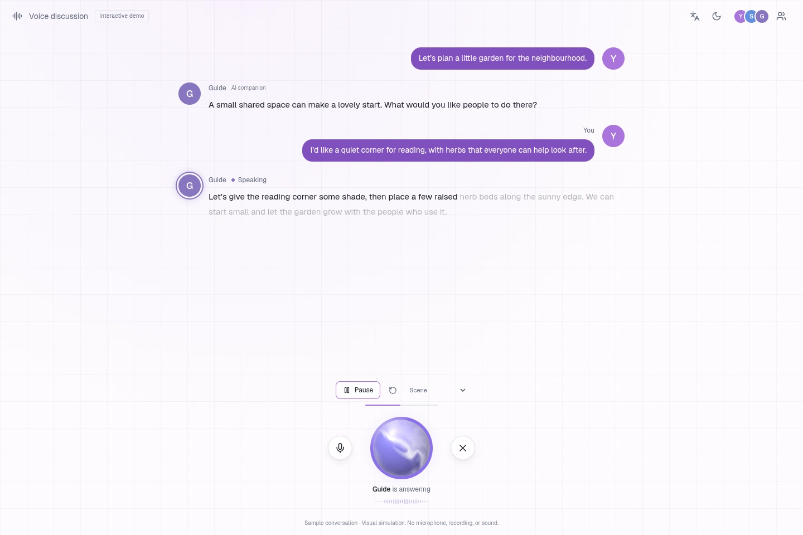

# Voice Mode UI · 语音模式 UI

[English portfolio](https://jjchess.github.io/Eregion/projects/voice-mode-ui/) · [中文作品页](https://jjchess.github.io/Eregion/zh/projects/voice-mode-ui/) · [Interactive demo](https://jjchess.github.io/Eregion/demos/voice-mode-ui/) · [Source](src/)



## English

Voice Mode UI is a set of chat components that turns the composer into a voice dock. A liquid orb, speaker colors, progressive transcripts and a compact waveform show whose turn it is and how the conversation is progressing. The entry button and active orb share a transition; the same conversation remains visible while the controls change.

The archive extracts the current Edumanus chat implementation: `VoiceDock`, `VoiceControl`, `VoiceLiveText`, `SmoothHeight` and the native WebGL `VoiceOrb` renderer. A standalone English/Chinese chat shell supplies synthetic participants, example messages and a scripted self → preparing → Agent → peer sequence. Play, pause, replay, mute, end and reopen controls exercise the UI.

This is a silent interaction demo. Text and activity levels are simulated: it does not request microphone permission, capture or play real audio, perform speech recognition, contact an AI model or join a voice service. There are no real chat transcripts, recordings, invitation tokens or account records in the archive.

Built with React/TypeScript, native WebGL/GLSL, Framer Motion, use-intl and Vite. Geist is hosted locally.

### Run and build

Use Node.js 20.x at 20.19 or later, or Node.js 22.12 or later, as required by Vite 8.3.4. From the repository root:

```bash
cd works/voice-mode-ui/src
npm ci
npm run dev -- --port 4181
```

Open `http://127.0.0.1:4181/`. To check and build the static demo:

```bash
npm run typecheck
npm test
npm run build
```

The build writes `../demo/` with relative asset URLs and complete third-party notices. To preview the portfolio, return to the repository root:

```bash
python3 scripts/build.py
python3 scripts/serve.py --port 4179
```

The local work is at `/portfolio/projects/voice-mode-ui/`, its Chinese page at `/portfolio/zh/projects/voice-mode-ui/`, and its demo at `/portfolio/demos/voice-mode-ui/`. Production uses the same suffixes under `/Eregion/`. The demo requires JavaScript; the portfolio detail pages are static HTML.

### Provenance and contribution

- **Product source:** Edumanus frontend `app/chat/components/voice-mode.tsx`, its CSS and `voice-orb/`, reviewed at HEAD `b4df0c289de7cfd39fe39e6d555bd317e665c1aa`. Those source files were unchanged relative to that revision at review. The product's `/voice` route is an invitation landing page; this work represents the voice mode inside chat.
- **Orb renderer:** adapted from [beUI Voice Orb by Saurabh Chauhan](https://github.com/starc007/ui-components/tree/9deb728d936b5f89c859ab6c1f169235aa24b3ad/components/agents/voice-orb), at commit `9deb728d936b5f89c859ab6c1f169235aa24b3ad`. The renderer retains its upstream attribution and marked Edumanus modifications. Its full MIT license, © 2026 Saurabh Chauhan, accompanies this archive and demo.
- **Product work and archive adaptation:** Edumanus supplies the chat integration, speaker/state mapping, palette blending, voice controls, progressive text and transition behavior. This archive separates those components from authentication, microphone capture, PCM transport and room APIs, and adds a scripted bilingual demonstration. It does not claim that the upstream orb design or renderer is wholly original.

The older `voice` prototype's ElevenLabs-derived material, reference footage and audio behavior are not included. No images, models, textures or recorded voices are required by this orb. Third-party dependency and font terms are retained in [THIRD_PARTY_NOTICES.md](THIRD_PARTY_NOTICES.md) and `licenses/`. The reviewed product source had no blanket application license; this archive does not grant a new one.

### Validation and limitations

A clean `npm ci`, type checking and the static production build passed. Five tests passed: scene/turn boundaries, mute and Agent membership behavior, complete deterministic bilingual transcripts, bounded simulated activity, and the speaker-ID-to-activity-reader mapping used by the actual dock. The static output contains the same notice and all 14 complete license texts as the source archive.

The 1440 × 960 preview is a direct official Chrome CDP WebP capture and has been visually reviewed. All nine browser check groups passed in official Chrome 155.0.8059.84:

- Play drives the simulated activity; pause freezes captions; replay resets the sample. Self, preparing, Agent and peer states retain their palettes and progressive transcripts.
- Mute affects the self turn, while participant controls, modal focus/Escape, end/composer and a single reopened orb remain usable. English/Chinese and light/dark switches preserve the scene; Chinese status text and the input focus indicator were checked.
- At 390 px, growing captions follow the latest turn; a real CDP touch swipe upward preserves the reader's position, and replay restores following. At 390/320 px, touch controls, captions, reduced motion and scroll boundaries passed without horizontal overflow.
- WebGL creation failure retains the still orb, captions and controls. Exercised flows made no device, audio or transport calls, business requests or remote-asset requests, and had no failed resources or uncaught exceptions.

With the portfolio preview running on port 4179 and official Chrome already exposing CDP 9224, run the browser harness from the repository root using an installed Playwright package:

```bash
CDP_PORT=9224 PLAYWRIGHT_MODULE=/path/to/playwright node tests/voice-browser.cjs
```

The harness attaches to that Chrome instance. GitHub Actions publishes approved works through Pages; the public links above use its formal `/Eregion/` path.

Simulated activity does not demonstrate real audio analysis, transcription accuracy, multiplayer transport or AI response quality. Touch checks used browser-level input, not a physical phone. Physical phone/trackpad elastic scrolling and hardware frame rates have not been measured. The GPU fallback test covers context creation failure, not loss of an existing context.

## 中文

语音模式 UI 是一组将聊天输入区转换为语音控制台的组件。流动球体、说话人配色、逐步字幕和简洁波形共同表达对话进度；入口按钮与通话中的球体使用共享转场，切换控件时仍保留同一段聊天。

本作品整理自当前 Edumanus 聊天界面的 `VoiceDock`、`VoiceControl`、`VoiceLiveText`、`SmoothHeight` 及原生 WebGL `VoiceOrb` 渲染器。独立的中英文外壳提供合成成员、示例文字和「本人 → 准备回答 → Agent → 同伴」时间线，通过播放、暂停、重播、静音、结束及重新进入体验状态变化。运行与构建命令见上方共用说明。

这是无声的交互演示：文字和动态强度均为模拟，不请求麦克风权限、不采集或播放真实音频、不做语音识别、不调用 AI，也不连接真实语音房间。归档不包含用户聊天、录音、邀请令牌或账号记录。

技术栈为 React、TypeScript、原生 WebGL/GLSL、Framer Motion、use-intl 和 Vite，Geist 字体本地托管。Node.js 版本要求与运行命令见上方共用说明。

### 来源与贡献

产品源码来自 Edumanus 的 `app/chat/components/voice-mode.tsx`、对应 CSS 和 `voice-orb/`，审查版本为 `b4df0c289de7cfd39fe39e6d555bd317e665c1aa`，相关文件与该版本一致。产品 `/voice` 页面仅用于邀请进入，本作品对应聊天中的语音模式。

球体渲染器改编自 Saurabh Chauhan 的 beUI Voice Orb，版本为 `9deb728d936b5f89c859ab6c1f169235aa24b3ad`；保留上游出处、Edumanus 修改标记和 © 2026 Saurabh Chauhan 的完整 MIT 许可。产品实现贡献是聊天集成、说话人/状态映射、配色渐变、语音控件、逐步字幕及转场；本次归档移除认证、麦克风采集、PCM 传输和房间 API，补充独立双语演示，不将上游球体设计或渲染器宣称为全部原创。

旧 `voice` 原型中的 ElevenLabs 材质、参考录像和音频行为不在此作品中。当前球体无需图片、模型、纹理或录音。第三方依赖与字体保留各自许可，详见 [THIRD_PARTY_NOTICES.md](THIRD_PARTY_NOTICES.md)。源产品未提供覆盖全部应用代码的统一许可证，本归档不替它另行授予许可。

### 验证与限制

干净环境中的 `npm ci`、类型检查和静态构建均已通过。五组测试通过，覆盖场景与轮次边界、静音及 Agent 成员状态、完整且可重现的双语字幕、范围有效的模拟动态数值，以及真实控制台使用的说话人 ID 到动态读取器的映射。静态输出包含与源码一致的声明及全部 14 份完整许可证。

1440 × 960 预览是官方 Chrome 通过 CDP 直接捕获的 WebP，并已完成人工视觉检查。官方 Chrome 155.0.8059.84 的九组浏览器检查全部通过：

- 播放驱动模拟动态，暂停冻结字幕，重播重置示例；本人、准备回答、Agent、同伴状态保持对应配色和逐步字幕。
- 静音只影响本人发言；成员操作、弹窗焦点/Escape、结束后的输入区及重新进入后的单个球体正常。中英文和明暗主题切换保留场景，中文状态文字与输入焦点提示已检查。
- 390 px 下新增字幕跟随当前轮次；真实 CDP 触控上滑后保留阅读位置，重播恢复跟随。390/320 px 的触控、字幕、减少动态效果和滚动边界均通过，没有横向溢出。
- WebGL 创建失败后仍可使用静态球体、字幕及控件。测试流程没有设备、音频、传输接口、业务或远程素材请求，也没有资源失败或未捕获异常。

浏览器检查命令见上方：需要先运行 4179 本地预览，并连接已开启 CDP 9224 的官方 Chrome。正式发布由 GitHub Actions Pages 流程完成，公开链接采用 `/Eregion/` 路径。

模拟动态不代表真实音频分析、转写精度、多人传输或 AI 回答质量。触控检查使用浏览器级输入，不是物理手机实测。物理手机/触控板的弹性滚动和硬件帧率尚未实测。GPU 降级测试覆盖上下文创建失败，不包含已有上下文丢失。
